# Bench Wizard

A local web wizard that sets up a Frappe bench (version 15 or 16) on Ubuntu or macOS. It checks
prerequisites, installs what is missing, then runs `bench init`, `get-app`, `new-site`
and `install-app` for the apps you choose, optionally restoring a database backup. It can also
**add apps to a bench you already have**, add a new site to it from a backup, or **migrate several of its sites
at once**.

Its **Projects** screen lists every bench on the machine with its sites, ports, memory use and state. From there
you start and stop benches, run `migrate` or `build`, and give each bench ports of its own so several can run side
by side. **Manage** opens one bench up close: open a site signed in as Administrator, back sites up and restore them
as copies, update apps or move them to another branch, read its logs, and download backups from Frappe Cloud. Apps
can come from the catalog, any Git URL, or the free apps in the **Frappe Cloud Marketplace**.

Python 3.10+ standard library only. No build step, no dependencies.

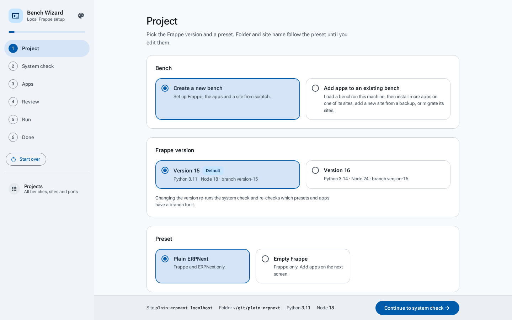

## Contents

- [What you can use it for](#what-you-can-use-it-for)
- [Quick start](#quick-start)
- [How it works](#how-it-works)
- [Using the wizard, step by step](#using-the-wizard-step-by-step)
- [Adding apps to an existing bench](#adding-apps-to-an-existing-bench) · [Migrating several sites at once](#migrating-several-sites-at-once)
- [Projects: every bench on this machine](#projects-every-bench-on-this-machine)
- [One bench up close: sites, apps, backups and logs](#one-bench-up-close-sites-apps-backups-and-logs)
- [Several runs at once](#several-runs-at-once)
- [Browser extension: copy apps from a Frappe Cloud site](#browser-extension-copy-apps-from-a-frappe-cloud-site)
- [Which GitHub account it uses](#which-github-account-it-uses)
- [Catalog: your own apps and presets](#catalog-your-own-apps-and-presets)
- [Appearance: colours, dark mode and backgrounds](#appearance-colours-dark-mode-and-backgrounds)
- [macOS](#macos) · [Troubleshooting](#troubleshooting) · [Tests](#tests) · [Notes](#notes) · [Future plans](#future-plans) · [License](#license)

## What you can use it for

| You want to… | What the wizard does for you |
|---|---|
| **Onboard a developer** on a fresh Ubuntu or Mac | Installs Python, Node (via nvm), MariaDB, Redis, wkhtmltopdf, Yarn and the Bench CLI, then builds a working bench and site in one run. |
| **Reproduce a production issue locally** | Restores a `.sql`/`.sql.gz` backup (plus public/private files) as a new site, with switches that mute email, pause the scheduler and hold back webhooks/SMS so the copy cannot reach real customers. |
| **Mirror a Frappe Cloud site** | The [browser extension](#browser-extension-copy-apps-from-a-frappe-cloud-site) copies the site's apps, repos and branches into the wizard, so your local bench matches what runs in the cloud; [Frappe Cloud backups](#backups-from-frappe-cloud) brings its data down too. |
| **Try an app** on a bench you already use | [Existing-bench mode](#adding-apps-to-an-existing-bench) fetches only what is missing, installs it on the site you pick and rebuilds assets. |
| **Standardise team setups** | A shared `catalog.json` (or your own `~/.config/bench-wizard/catalog.json`) gives everyone the same versions, apps and presets. |
| **Run several projects on one machine** | [Projects](#projects-every-bench-on-this-machine) finds every bench, shows which share ports, and gives each its own web, Socket.IO and Redis ports so they can run at the same time. |
| **Start, stop and watch benches** | Start or stop any bench from one screen, see the memory each running bench holds, and get a warning when memory or disk runs low. |
| **Migrate many sites after a pull** | [Migrate sites](#migrating-several-sites-at-once) backs up and migrates the sites you tick, side by side, each with its own log, and says which patch failed and why. |
| **Look into a site quickly** | [Open as Administrator](#sites) opens the desk already signed in; the bench's [logs](#logs) are searchable, with errors in red. |
| **Copy a site for testing** | [Back up](#backups) a site, then **Restore as a new site**: a UAT copy with email muted and the scheduler paused. |
| **Keep apps up to date** | [Check for updates](#apps) shows how many commits each app is behind; **Update** or **Change branch** pulls, migrates and builds. |
| **Try a Marketplace app** | Pick a free app from the [Frappe Cloud Marketplace](#3-apps); the wizard finds its repository and the branch for your Frappe version. |
| **Work with private apps** | Paste a token-carrying HTTPS URL or choose an SSH host alias; the token is kept in memory only and scrubbed from logs. |

## Quick start

```bash
git clone https://github.com/rajitjosh/bench-wizard.git
cd bench-wizard
./start.sh                                # or: python3 -m bench_wizard
```

It opens `http://127.0.0.1:<port>/` in your browser (local only, token protected). Keep the terminal open
while you use it; press Ctrl+C, or **Quit Bench Wizard** in the side bar, to stop. Benches you started from the
wizard keep running.

| Option | What it does |
|---|---|
| `--install-desktop` | Adds an app-menu icon and exits (on a Mac: `~/Applications/Bench Wizard.app`). |
| `--app` | Opens the wizard in a window of its own and stops when that window is closed. The desktop icon uses this. |
| `--no-browser` | Starts the server and prints the URL without opening a browser. |
| `--port N` | Listens on port `N`. By default it takes the first free port of 47615–47619 (the extension looks there). |

**The desktop icon.** A window of its own needs Chrome, Chromium, Edge or Brave; set
`BENCH_WIZARD_BROWSER=/path/to/browser` to pick one. Without any of them the wizard opens in a tab of your default
browser (Firefox, Safari) and keeps running after the tab is closed, until you press **Quit Bench Wizard**. Opening
the icon again goes back to that wizard. The icon points at this folder: after moving or renaming it, run
`./start.sh --install-desktop` again. To remove the icon, delete `~/.local/share/applications/bench-wizard.desktop`
(Linux) or `~/Applications/Bench Wizard.app` (Mac). Whatever the wizard prints when started from the icon goes to
`~/.local/state/bench-wizard/app.log`.

## How it works

The wizard is a small Python HTTP server bound to `127.0.0.1` that serves a single-page UI. Every request
from the page carries a per-run token, so other local pages cannot drive it. Nothing is written to disk until
you press **Start setup** on the Review step; the [Projects](#projects-every-bench-on-this-machine) screen only reads
files until you press one of its buttons.

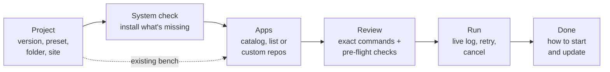

Behind the Run step, a new bench is built in this order. Apps are installed in dependency order, worked out
from each app's own `pyproject.toml` and `hooks.py`:

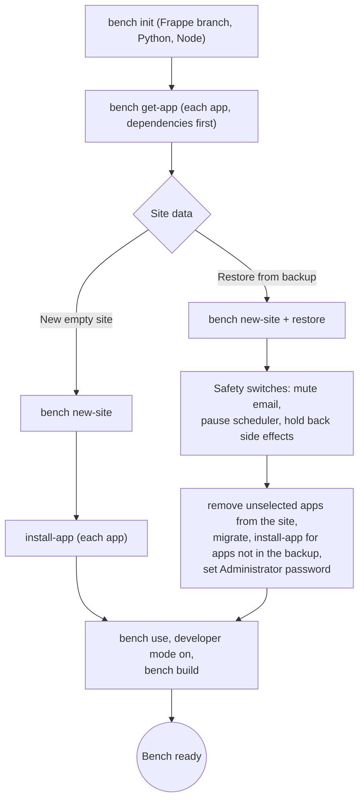

## Using the wizard, step by step

### 1. Project

Choose **Create a new bench** or **Add apps to an existing bench** ([see below](#adding-apps-to-an-existing-bench)).
For a new bench pick:

- **Frappe version.** Version 15 (Python 3.11, Node 18) or Version 16 (Python 3.14, Node 24).
- **Preset.** A starting set of apps, for example *Plain ERPNext* or *Empty Frappe*. Folder and site name follow
  the preset until you edit them.
- **Bench folder** (must not exist yet, no spaces), **site name** (`*.localhost` opens in Chrome and Firefox
  without a hosts entry), optional **database name**, and the **Administrator password**.
- **Site data.** A new empty site, or **Restore from backup**: a `.sql`/`.sql.gz` path, optional public/private
  file archives, an optional backup encryption key and the source site's `encryption_key`.

Until you press **Start**, **Start over** in the side bar clears every choice and goes back to this step. It asks
first, and nothing on disk changes.

### 2. System check

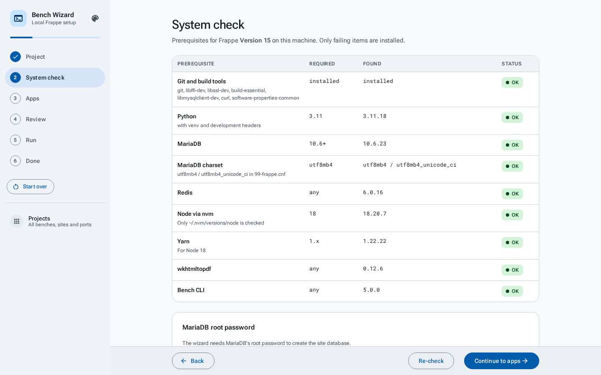

Each prerequisite is listed with the version required and found. Only failing rows are installed: with `apt`
and sudo on Ubuntu, or Homebrew on a Mac. The wizard then needs the **MariaDB root password** to create the
site database. Click **Verify**. If root has no password yet (a fresh install), it can set the one you typed.
**Continue** unlocks once every row is OK and the password is verified.

### 3. Apps

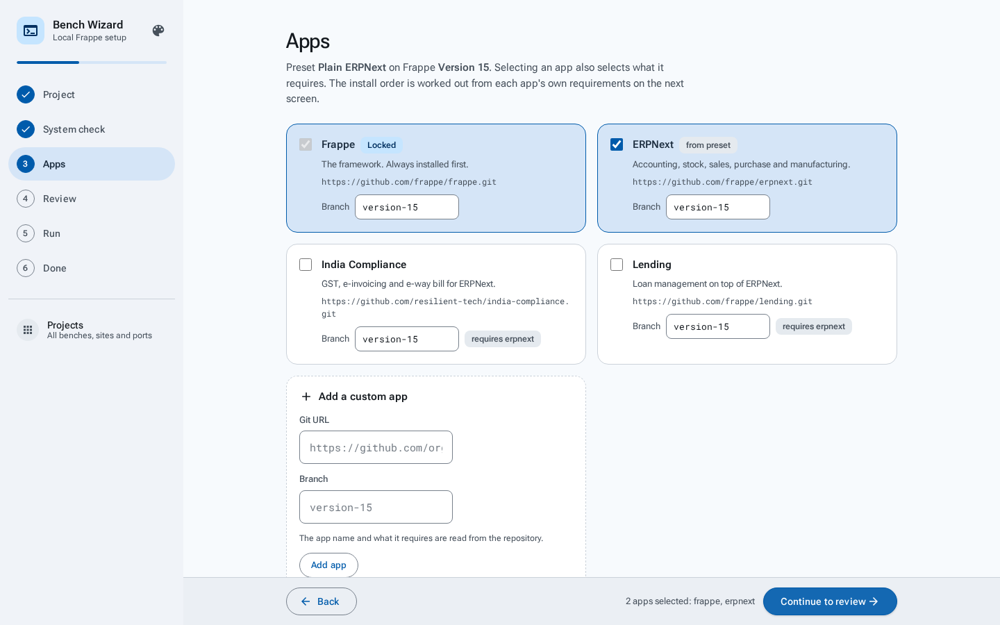

- Tick apps from the catalog; each shows its repo, branch (tags work too) and what it requires. Selecting an
  app also selects what it needs.
- **Add a custom app** from any Git URL. Its name and requirements are read from the repository.
- **Paste an app list** as JSON, `[{"url": "…", "branch": "…"}]`. This is what the
  [extension](#browser-extension-copy-apps-from-a-frappe-cloud-site) fills for you.
- **Frappe Cloud Marketplace.** Type an app's name (the list is the Marketplace's published apps) and click
  **Look up**. The wizard reads the app's public Marketplace page for its repository, supported versions and
  whether it is free, then lists the repository's branches with the one for your Frappe version first. **Add app**
  adds it like a custom app. A repository the page links to that is private or gone is reported as such.
- **Import from Frappe Cloud** shows whether the extension is connected.

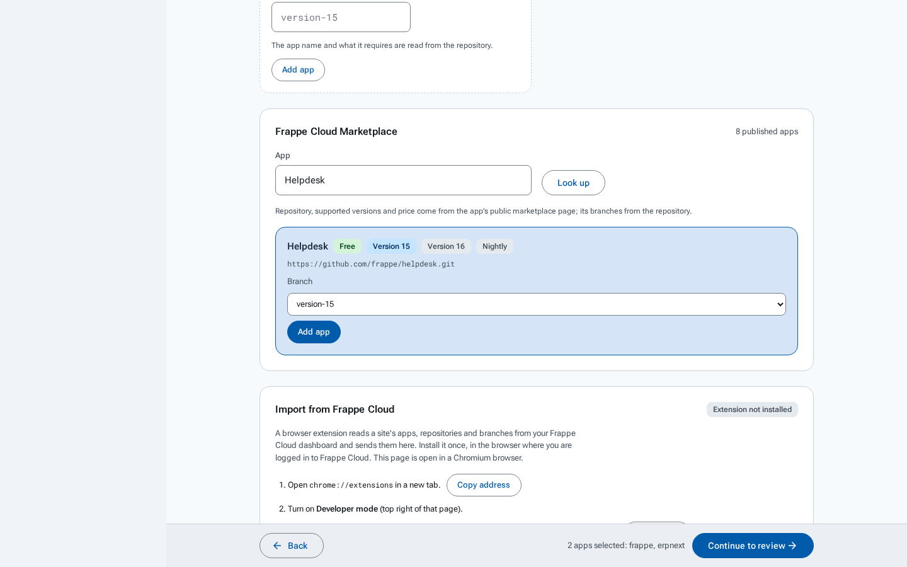

Private HTTPS URLs may carry a token (`https://<token>@github.com/org/repo.git`). It is passed to git through
the environment, held in memory for the session only, and scrubbed from logs.

### 4. Review

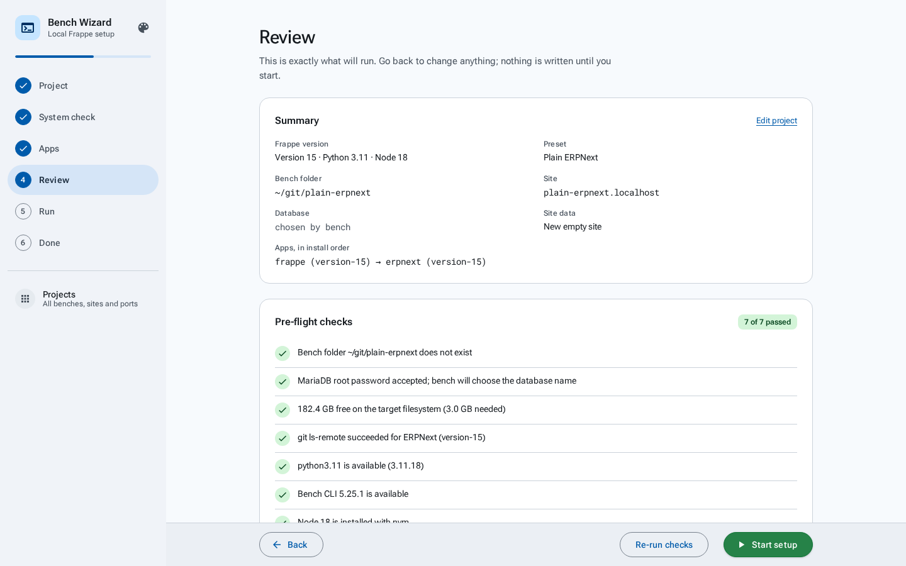

The exact commands that will run (secrets shown as `••••`), the install order, and pre-flight checks: bench
folder free, MariaDB login, disk space, `git ls-remote` for every app, Python, Bench CLI and Node.
**Start setup** is disabled while any check fails.

### 5. Run

A live log for each step. If a step fails, the run stops there. Fix the cause, then **Retry step N**. If the step
cannot run over a partial result, the wizard cleans that up first. **Cancel** stops the current step and leaves
what was created on disk. The run is listed under **Runs** in the side bar, so you can start
[another one](#several-runs-at-once) and come back to it.

### 6. Done

How to start the bench (`cd <folder> && nvm use && bench start`, or **Start** on the Projects screen), the site URL
and login, the installed apps, and the command to update later:

```bash
cd ~/frappe-bench && nvm use && bench update --pull --build --patch
```

For a restored site it also lists which safety switches were applied.

## Adding apps to an existing bench

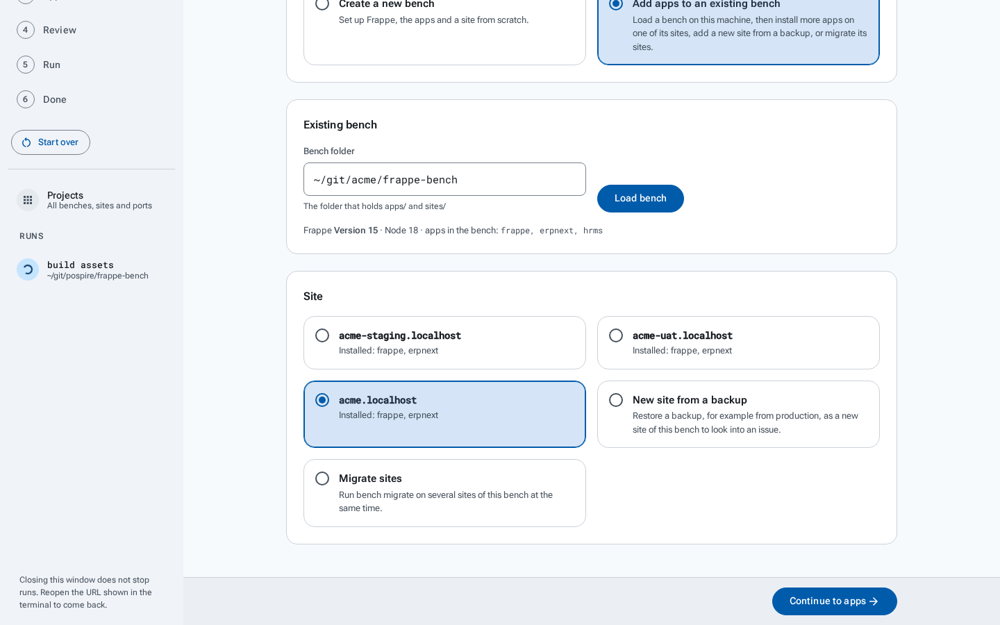

Choose **Add apps to an existing bench** on the Project step, type the bench folder (the one holding `apps/`
and `sites/`) and click **Load bench**. The wizard reads:

- the **Frappe version**, from `apps/frappe/frappe/__init__.py`. Any version works, 13 and 14 included; for one
  the catalog does not list, Python comes from the bench's own `env`. (New benches are set up on the catalog's
  versions only, since the wizard has to know which Python and Node to install.)
- the **Node version**, from the bench's `.nvmrc`, or your nvm default if there is none,
- the **apps in the bench**, from `sites/apps.txt`,
- each **site** and the apps installed on it, via `bench --site <site> list-apps`.

Then pick one of:

- **An existing site.** The wizard goes straight to Apps. Apps already in the bench show *already in the bench*
  and are only installed on the site; the rest are fetched.
- **New site from a backup.** Restore a production backup as a new site of this bench, for example to look
  into an issue. You get the same file, key and safety-switch fields as a new bench.
- **Migrate sites.** Run `bench migrate` on several sites of the bench at once; see
  [below](#migrating-several-sites-at-once).

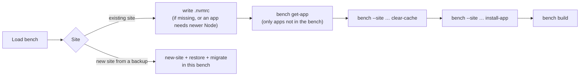

Nothing in this mode removes anything from the bench, and the existing site keeps its own database login, so the
MariaDB root password is not needed unless you add a site. If the bench has no `.nvmrc`, or an app needs a newer
Node than the bench uses, the wizard writes the bench's `.nvmrc` so `nvm use` picks the right one.

## Migrating several sites at once

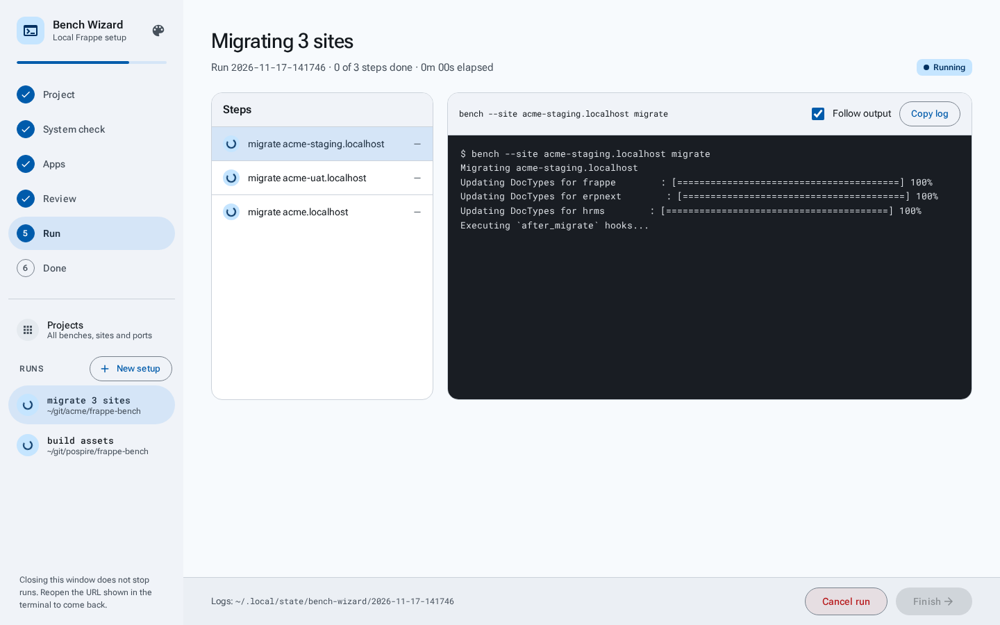

Load a bench on the Project step, choose **Migrate sites** and tick the sites. With **Back up each site first** (on
by default), each site runs `bench --site <site> backup --with-files` and then `migrate`, in the same step, so a
site's migrate waits for its own backup. **Start migrate** runs the sites at the same time, each with its own log. The
run starts the bench's own Redis while it works, since migrate queues jobs. If some fail, **Retry failed** runs only those
again. The Projects screen's **Migrate** button does the same for one site, or all of a bench's sites, without the
wizard steps.

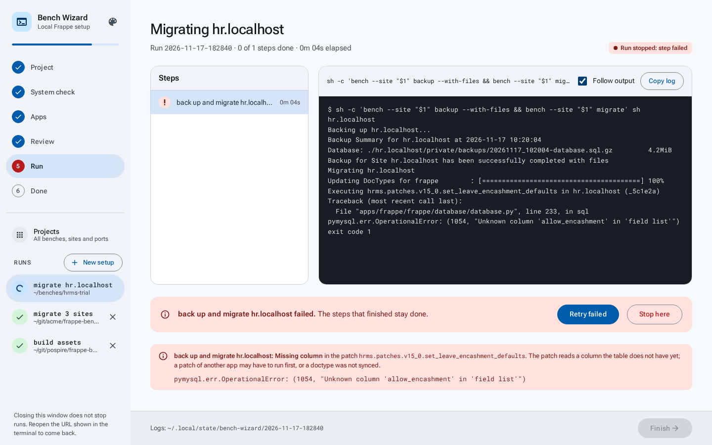

When a migrate fails, the run screen says **why**: the patch it was in (the last `Executing … in` line), the kind
of failure, with what it usually means, and the error line itself. It recognises a missing column, a missing table,
duplicate rows, a value too long for its column, and text where a number belongs.

## Projects: every bench on this machine

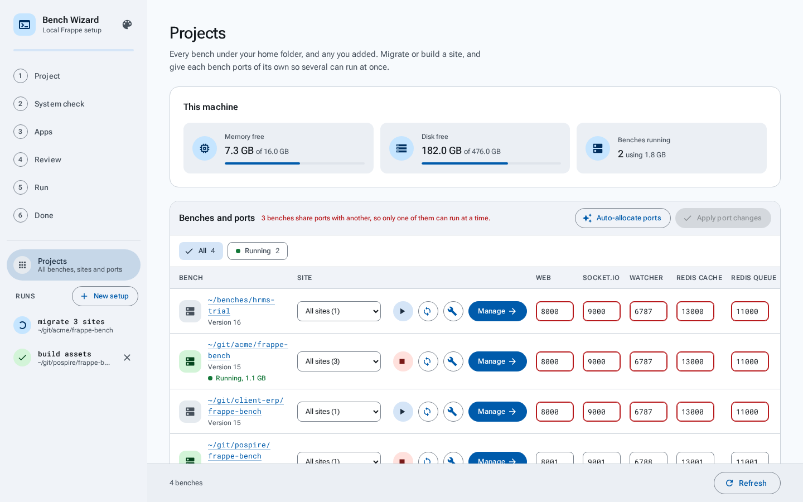

Click **Projects** in the side bar. The wizard looks for benches (a folder with `apps/frappe` and `sites/`) up to
three folders deep in your home folder, skipping hidden folders and the inside of benches, so the scan takes well
under a second.

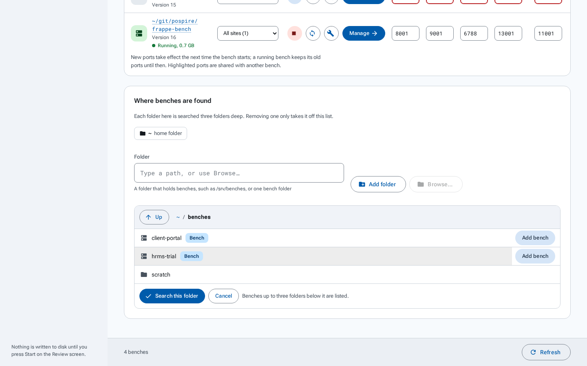

**Where benches are found**, at the bottom, lists the folders searched. Type a path or click **Browse…** to walk
the disk in the page: folders that are benches are marked, with an **Add bench** button, and **Search this folder**
adds the folder you are in, so benches up to three folders below it are listed too (for example `/srv/benches`). A
bench folder added on its own is listed by itself. The × on a chip takes it off the list; nothing on disk changes.
Searched folders are kept in `~/.local/state/bench-wizard/folders.json`; benches added by hand, and every bench the
wizard creates, in `benches.json` next to it.

**This machine** shows free memory and disk, how many benches are running and the memory they hold. A red bar and
a note appear when less than 2 GB of memory or 10 GB of disk is free; the same note shows on the Review step before
you start a run.

Each bench row has:

| Control | What it does |
|---|---|
| **Site** | The site Migrate acts on, or *All sites*. |
| **Start** | Runs `bench start` in the bench, in a session of its own, so it keeps running after you close the wizard. Its output goes to the bench's `logs/bench-start.log`. It is refused while one of the bench's ports is in use, and if `bench start` stops within 3 seconds (for example Redis could not bind its port), its last lines are shown. |
| **Stop** | Stops the bench the way Ctrl+C does: honcho stops every process it started. |
| **Migrate** / **Build** | Run `bench --site … migrate` or `bench build` right away, as a run you can follow under **Runs**. |
| **Manage** | Opens the [bench's own page](#one-bench-up-close-sites-apps-backups-and-logs). Clicking the bench's name does the same. |
| **Ports** | The bench's web, Socket.IO, file watcher, Redis cache and Redis queue ports. Ports shared with another bench are outlined in red. |

The **All / Running** chips above the table show every bench or only the ones running now. In a window narrower
than about 1,640 pixels, Start, Stop, Migrate and Build show only their icons (their names show on hover), so the
table fits without scrolling sideways.

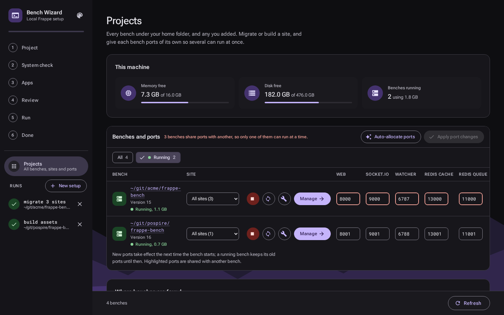

### Ports of its own for every bench

`bench init` picks ports by looking only at sibling bench folders, so benches in different folders usually all get
8000, 9000, 11000 and 13000, and only one of them can run at a time. The wizard gives each bench a **slot** *n*,
with every port at bench's default plus *n*:

| Slot | Web | Socket.IO | File watcher | Redis cache | Redis queue |
|---|---|---|---|---|---|
| 0 (bench's defaults) | 8000 | 9000 | 6787 | 13000 | 11000 |
| 1 | 8001 | 9001 | 6788 | 13001 | 11001 |
| *n* | 8000 + *n* | 9000 + *n* | 6787 + *n* | 13000 + *n* | 11000 + *n* |

**Auto-allocate ports** fills in new ports for every bench that shares one with another. Running benches keep
theirs; each moved bench gets the first slot no bench uses and nothing on the machine listens on. Check the
highlighted fields (or type your own) and click **Apply port changes**. For each bench this runs three steps:

1. `bench config set-common-config` for the ports and the Redis URLs in `sites/common_site_config.json`,
2. `bench setup redis`, which rewrites `config/redis_cache.conf` and `redis_queue.conf`,
3. sets `--port` on the `web:` line of the bench's `Procfile`, leaving its other lines as they are.

A bench uses its new ports the next time it starts, so its sites then open on the new web port. New benches made
by the wizard get a free slot from the start.

## One bench up close: sites, apps, backups and logs

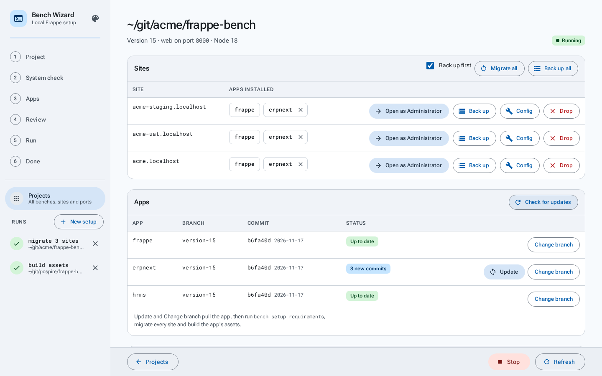

**Manage** on the Projects screen opens one bench: its version, web port and Node, whether it is running (with
**Start** or **Stop** at the bottom), and four sections. Every action that changes something runs like any other run,
with a live log, **Retry** and **Cancel**, and ends with **Back to the bench**.

### Sites

Each site shows the apps installed on it. On each site:

| Button | What it does |
|---|---|
| **Open as Administrator** | Opens the site's desk in a new tab, already signed in, using Frappe's own login. A stopped bench is started first, since the sign-in is kept in its Redis and its web server serves the desk; the tab waits, up to a minute, until both answer. The site's name must open in a browser: names ending in `.localhost` always do; any other needs a line in `/etc/hosts`. |
| **Back up** | `bench --site … backup --with-files`. **Back up all** does every site, side by side. |
| **Config** | Edits the site's `site_config.json`. Passwords and keys show as `********` and keep their value unless you type a new one; the file must stay valid JSON and keep its `db_name`. |
| **Drop** | `bench drop-site`, after asking for the MariaDB root password. bench backs the site up first and moves its folder to `archived_sites`. |
| **×** on an app | `bench --site … uninstall-app … --yes`, after you confirm. bench backs the site up first; the app stays in the bench. |

**Migrate all**, with **Back up first**, migrates every site of the bench as described [above](#migrating-several-sites-at-once).

### Apps

Each app's branch and last commit. **Check for updates** fetches each app's remote branch and shows how many new
commits it has, or *Up to date*; *Local changes* means files in the app were edited. **Update** pulls the new
commits (`bench update --pull --apps <app>`); **Change branch** lists the repository's branches and moves the app to
the one you pick (`bench switch-to-branch`). Both then run `bench setup requirements`, migrate every site and build
that app's assets.

### Backups

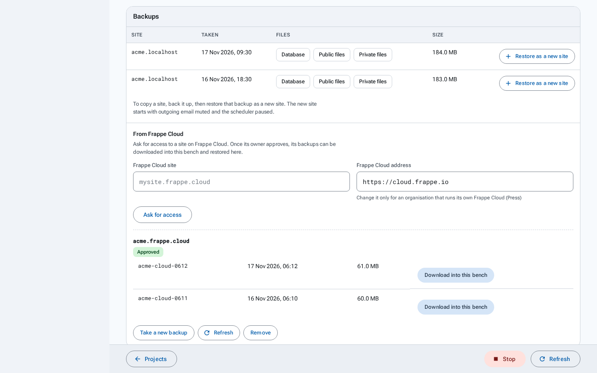

Every backup in the bench's sites, newest first, with the files it has and its size. **Restore as a new site** opens
the wizard's [New site from a backup](#adding-apps-to-an-existing-bench) form for this bench, filled in. That is how
to **copy a site**, for example for UAT: back it up, then restore it under a new name. The copy starts with outgoing
email muted and the scheduler paused.

#### Backups from Frappe Cloud

Type a Frappe Cloud site's address (`mysite.frappe.cloud`) and click **Ask for access**. The wizard shows a code
and a link; someone on that site's team signs in to Frappe Cloud, opens the link and approves the request, checking
the code matches. **Check again** then lists the site's backups; **Download into this bench** fetches one into
`fc-backups/<site>/` in the bench, where it shows under Backups, ready to restore. **Take a new backup** asks
Frappe Cloud for a fresh one, and **Remove** withdraws the access.

- Nothing is configured in the wizard: no API key or Frappe Cloud login. The approval is the permission.
- It uses Frappe Cloud's migration API, which serves a site's offsite backups. Sites from several teams can be
  listed at once, each with its own access.
- **Frappe Cloud address** is `https://cloud.frappe.io` for everyone, except an organisation that runs its own
  Frappe Cloud (Press); each site keeps the address it was added with.
- The access token is kept in `~/.local/state/bench-wizard/frappe-cloud.json`, readable only by you. The download
  links are signed and short-lived, and are not written to the run's log.

### Logs

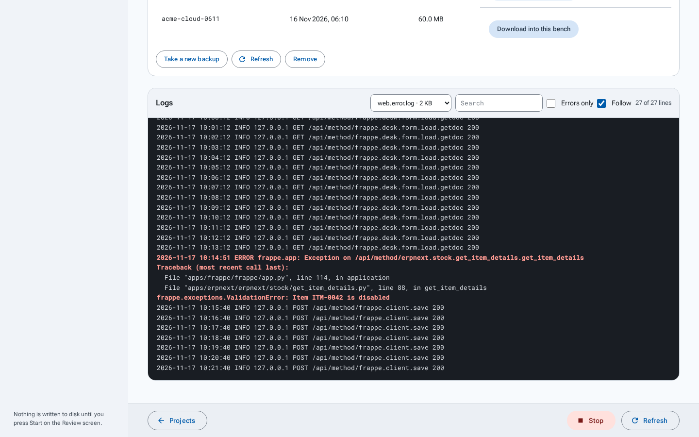

Pick any file in the bench's `logs/` folder. **Search** keeps only the lines with the text, **Errors only** keeps
error lines and tracebacks (shown in red anyway), and **Follow** adds new lines as the bench writes them.

## Several runs at once

Every setup, migrate, build or port change is a **run**, listed under **Runs** in the side bar with its state.
While one runs you can click **New setup** and start another: a second bench, a migrate in another bench, a build.
Click a run to see its steps and log again; the × removes a finished run from the list. Two runs that work in the
same bench folder are refused, so they cannot get in each other's way. Closing the window does not stop runs:
reopen the wizard's URL to come back to them.

## Browser extension: copy apps from a Frappe Cloud site

`extension/` is a small browser extension for Chromium-based browsers (Chrome, Edge, Brave). It lists
the apps on one of your Frappe Cloud sites as `[{"app", "url", "branch", "commit"}]` and sends them to the
wizard's Apps step.

### Install it

Browsers do not let a web page install an extension, so you load it once by hand. The wizard's Apps step shows
these steps in its **Import from Frappe Cloud** card until the extension connects, and its **Show folder** button
opens the `extension` folder for you.

| Browser | Open this page | Then |
|---|---|---|
| Chrome | `chrome://extensions` | Turn on **Developer mode** (top right) → **Load unpacked** → pick `bench-wizard/extension`. |
| Edge | `edge://extensions` | Turn on **Developer mode** (left sidebar) → **Load unpacked** → pick `bench-wizard/extension`. |
| Brave | `brave://extensions` | Turn on **Developer mode** (top right) → **Load unpacked** → pick `bench-wizard/extension`. |

Then pin it: click the puzzle-piece icon in the toolbar and pin **Bench Wizard: Frappe Cloud export**.

Firefox and Safari are not supported (the extension uses a Chromium Manifest V3 service worker).

**Updating.** After `git pull`, open the extensions page and click the reload icon on the extension's card.
**Removing.** Click **Remove** on the same card.

### Use it

1. Start the wizard and go to the **Apps** step. The Import from Frappe Cloud card turns to *connected* within a
   minute of the browser starting (or right after you load the extension).
2. Log in at `cloud.frappe.io/dashboard` (or `frappecloud.com/dashboard`). Open a site there to preselect it,
   then click the extension's icon.
3. Pick the site if needed and click **Send to Bench Wizard**. The list lands in **Paste an app list** for you to
   check before you click to add it. **Copy JSON** and **Download** work too, for example to share the list.

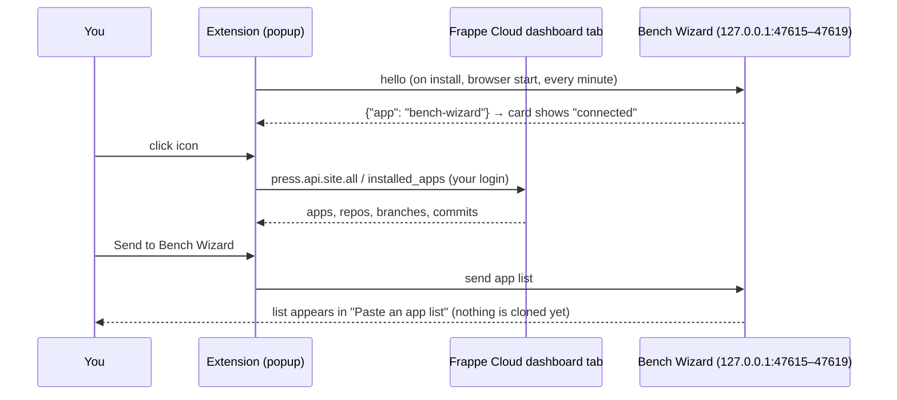

### Privacy and limits

- It calls the dashboard's own API (`press.api.site.all`, `press.api.site.installed_apps`) from inside the
  dashboard tab with your existing login. It stores nothing and needs no API key.
- These are internal dashboard endpoints, so a Frappe Cloud change may break it.
- Private repos still need your own Git token, or an [SSH host alias](#which-github-account-it-uses), in the wizard.
- A site may run an older commit than its branch head; the wizard clones the branch.
- The wizard listens on the first free port of 47615–47619 so the extension can find it. With `--port` it cannot.
- The two calls the extension makes need no token but are refused unless they come from an extension
  (`Origin: chrome-extension://…`), which web pages cannot fake. They only fill the import box.

## Which GitHub account it uses

With several GitHub accounts as SSH host aliases in `~/.ssh/config`, pick the one the wizard uses in
`~/.config/bench-wizard/settings.json`:

```json
{"github_ssh_host": "github-work"}
```

Every GitHub URL the wizard fetches (HTTPS or SSH, for `bench init`, `get-app` and the checks) then goes over
SSH through that alias and its key. It is passed to git through the environment of the wizard's own commands
only; your git config and other projects are unchanged. A token inside a URL still wins for its owner. The
bench's own remotes keep their original URLs, so a later `bench update` uses your normal git setup.

## Catalog: your own apps and presets

`catalog.json` lists Frappe versions, apps and presets. Add your own in `~/.config/bench-wizard/catalog.json`;
it is merged on top, and its presets show a *Local* badge.

```json
{
  "apps": {
    "my_app": {
      "title": "My App",
      "description": "Our internal customisations.",
      "repo": "git@github.com:my-org/my_app.git",
      "branches": {"version-15": "version-15", "version-16": "develop"},
      "requires": ["frappe", "erpnext"],
      "private": true
    }
  },
  "presets": {
    "my-stack": {"title": "My stack", "description": "ERPNext and My App.", "apps": ["erpnext", "my_app"]}
  }
}
```

An app with no branch for the chosen Frappe version shows *Not available* and cannot be selected.

## Appearance: colours, dark mode and backgrounds

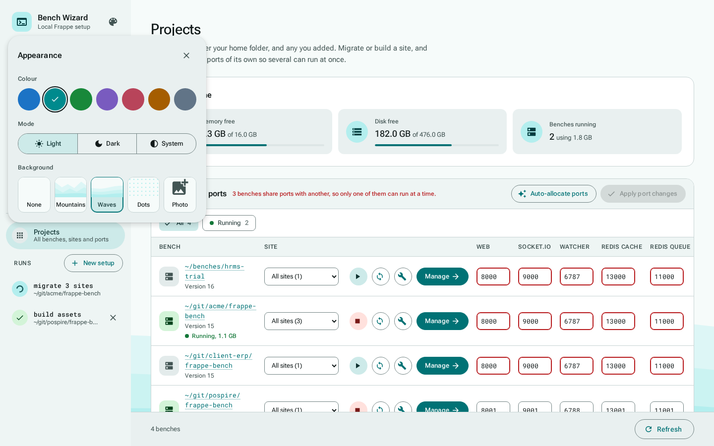

The palette button next to the title opens **Appearance**:

- **Colour.** Ocean (the default), Teal, Forest, Violet, Rose, Amber or Slate. The interface follows Material
  Design 3: each colour is a seed from which the whole set of tones, for buttons, selected cards, notes and the
  side bar, is worked out.
- **Mode.** Light, Dark, or System, which follows your computer's setting as it changes.
- **Background.** None, a drawn scene (Mountains, Waves, Dots) tinted in the chosen colour, or **Photo**: your own
  image. The photo is scaled down to at most 2400 pixels on its long side and kept as a JPEG of a few hundred KB;
  **Dim** sets how strongly it is faded behind the screens (never below 45%), and the page heading gets a panel of
  its own so it stays readable on any picture. **Change image** and **Remove** sit under it.

The choice is kept in the browser (its local storage), not in a file, so another browser starts with the defaults.

## macOS

Install [Homebrew](https://brew.sh) first; the wizard installs everything else through it, as your user.
Homebrew no longer packages wkhtmltopdf, so the wizard installs the upstream `.pkg` with sudo; it is an Intel
build and runs under Rosetta on Apple silicon. MariaDB runs as a Homebrew service, and the charset settings go to
`$(brew --prefix)/etc/my.cnf.d/99-frappe.cnf`. The app icon is `bench_wizard/web/icon.icns`, built from
`icon-mac.svg` (render it at 1024px, make an `.iconset` with `sips`, then run `iconutil -c icns`). In `--app` mode the wizard keeps running until you quit the
browser window with ⌘Q, since closing a window does not quit a Mac app.

The Projects screen finds running benches with `ps` and `lsof`, since macOS has no `/proc`. Its scan of your home
folder skips `Library`, `Pictures`, `Movies` and `Music`; looking in `Desktop`, `Documents` or `Downloads` may make
macOS ask once whether Terminal (or Python) may read that folder. Allow it if your benches live there. Opened in
Safari rather than in its own window, the wizard needs Safari 16.2 or later for its colours; on Safari before 17 the
Appearance panel opens without the browser's popover support.

The window belongs to a browser process of its own, so in the Dock it shows as a second browser icon (and
a minimised window goes into that icon when "Minimise windows into application icon" is on). Opening Bench
Wizard again, from Spotlight or the Applications folder, brings that window back, un-minimising it; only
if it was closed does a new one open. The wizard drives its window over the browser's DevTools protocol
on a private pipe (`--remote-debugging-pipe`), not a network port.

On Linux the launcher's `StartupWMClass` lets the desktop focus the open window itself. A snap browser
(Ubuntu's Chromium) keeps its window profile in `~/snap/<name>/common/`, since snaps cannot use hidden
folders in your home, and runs without the DevTools pipe, so reopening there opens a new window.

## Troubleshooting

| Symptom | What to do |
|---|---|
| The desktop icon does nothing | Read `~/.local/state/bench-wizard/app.log`. "needs Python 3.10 or later" on a Mac means Finder found the system `python3`; run `brew install python`. |
| **Continue to apps** stays disabled | Every System check row must be OK *and* the MariaDB root password verified. |
| "MariaDB did not accept this password" | Correct it, or on a fresh install use **Set this as the root password** (needs sudo). |
| **Start setup** is disabled | A pre-flight check failed. Fix it (for example remove a leftover bench folder) and click **Re-run checks**. |
| A step failed during Run | Open the step's log, fix the cause, then **Retry step N**. `pip`/`yarn` cache clashes usually pass on retry. |
| The extension card never shows *connected* | Start the wizard without `--port`, reload the extension, and make sure ports 47615–47619 are not all taken. |
| "new benches are set up on Version 15, Version 16 only" | A bench of another version can be used as an existing bench, but the wizard sets up new benches only on the catalog's versions. |
| **Open as Administrator** says the bench "may need longer" | The bench was started but its Redis did not take the sign-in within a minute. Wait a moment and click it again; the bench's `logs/bench-start.log` shows what it is doing. |
| "… does not resolve on this machine" | The site's name does not open in a browser. Add `127.0.0.1 <site>` to `/etc/hosts`, or use a site name ending in `.localhost`. |
| A Frappe Cloud site stays *Pending* | The request has not been approved yet. Someone on the site's team must open the approval link while signed in to Frappe Cloud. |
| A migrate failed with *Missing column* or *Duplicate rows* | The note under the run names the patch. Fix the data or run the patch it depends on, then **Retry failed**. |
| A site shows "Cannot read its apps" | `bench --site <site> list-apps` failed. Check that MariaDB is running and the site's config is valid. |
| **Start** says "port N is in use" | Another bench (or program) holds that port. Stop it, or use **Auto-allocate ports** and **Apply** so this bench gets ports of its own. |
| **Start** says "bench start stopped right away" | The lines shown come from `logs/bench-start.log` in the bench. A Redis "Address already in use" means a port clash; a missing `Procfile` means the bench needs `bench setup procfile`. |
| "another run is still working in this bench folder" | Wait for that run (under **Runs**) to finish, or cancel it. |
| A Marketplace app's branches cannot be listed | Its Marketplace page links to a repository that is private or gone. Ask the publisher for access, or add the app from where it lives now as a custom app. |
| **Stop**, or the running state, is unavailable | Running benches are found through `/proc` on Linux and `ps` plus `lsof` on a Mac. If neither works, stop a bench with Ctrl+C where it runs. |
| The Marketplace says "cannot reach Frappe Cloud" | Check the network. On a Mac with Python from python.org, the wizard already retries certificate errors with `curl`; running *Install Certificates.command* in that Python's folder fixes Python itself. |

## Tests

```bash
python3 -m unittest discover -s tests
```

## Notes

- Bench folder paths must not contain spaces.
- Passwords and tokens are never shown in logs, and never written to disk, except the Frappe Cloud access token
  (in a file only you can read) when you ask for access to a site.
- A new bench always goes into a new folder. Existing-bench mode only adds apps, or a new site, to a bench. Removing
  something (Drop, uninstalling an app) happens only on a bench's own page, after you confirm it, and bench backs the
  site up first.
- Screenshots in this README were taken from the wizard itself, with demo benches, a placeholder home folder and a
  stand-in `bench` command.

## Future plans

- **One System check install at a time.** Homebrew and apt hold locks, so installs started from two runs at once
  should queue rather than fail.
- **A Docker sandbox bench.** A throwaway bench in a container for trying something out, or for a functional team
  to test on without setting up a machine.
- **Appearance that follows you.** Keep the colour, mode and background with the wizard's settings instead of in
  one browser.

Concurrent `pip` and `yarn` runs share caches and can occasionally fail; retrying the step is the fallback.

## License

[MIT](LICENSE)
