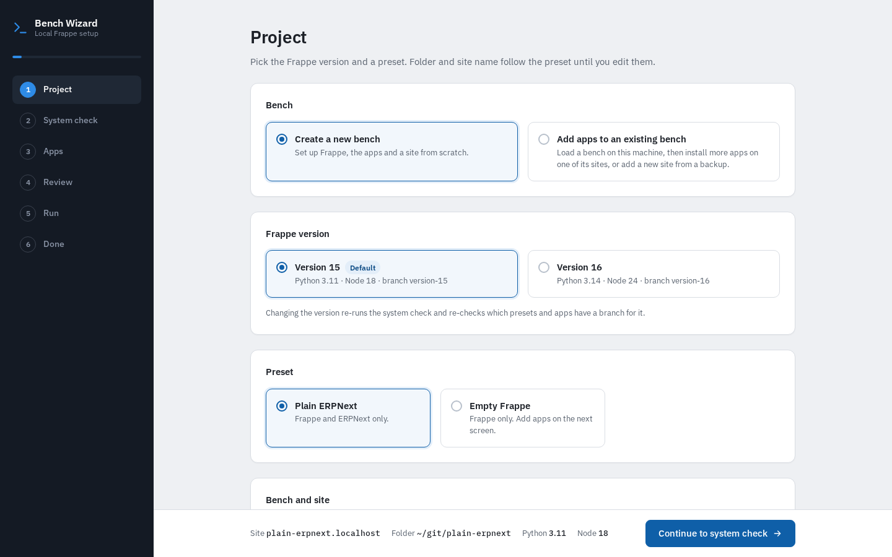
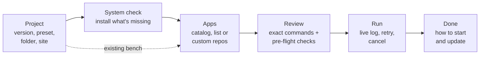
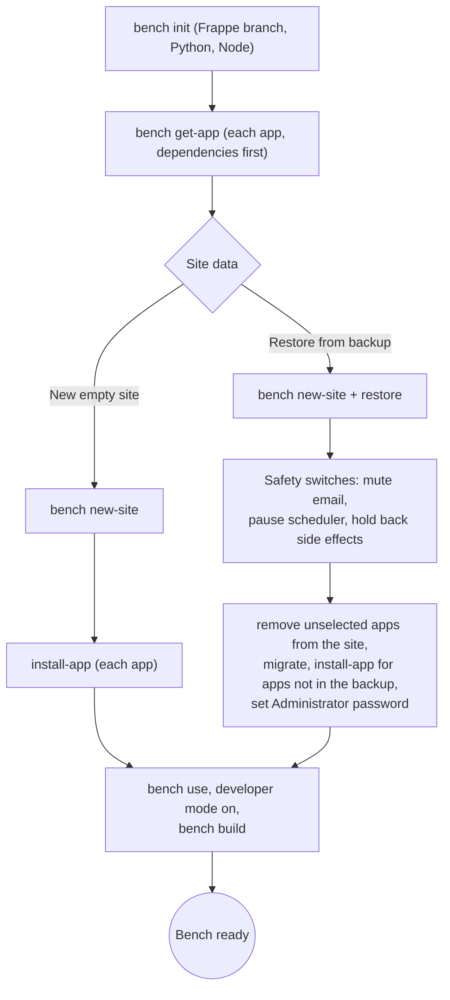
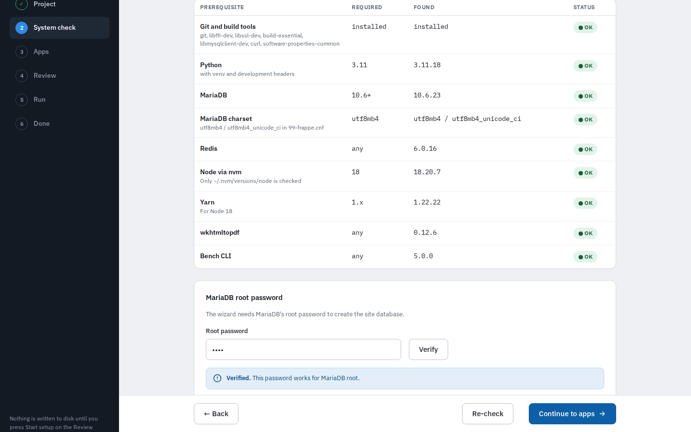
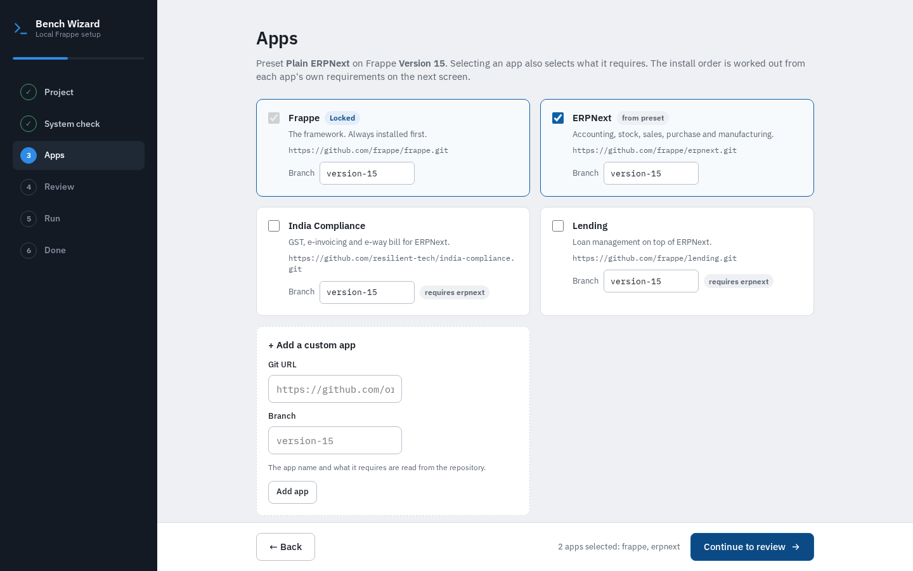
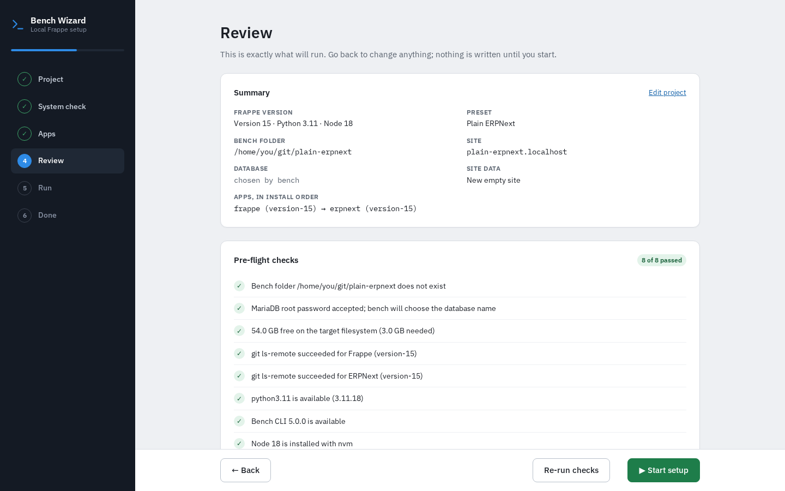
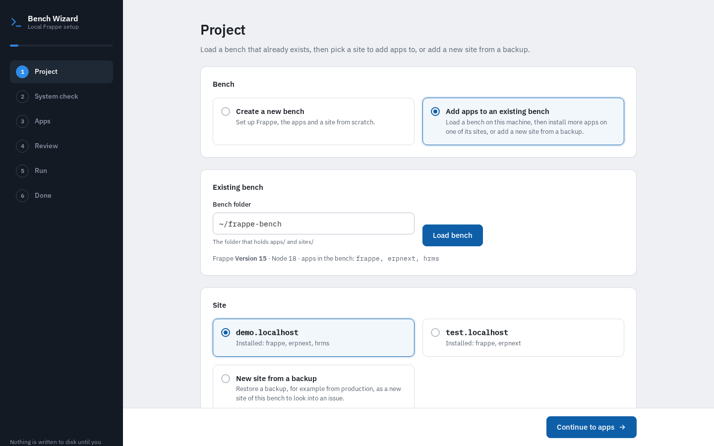
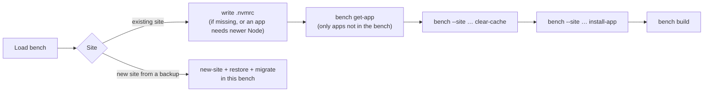
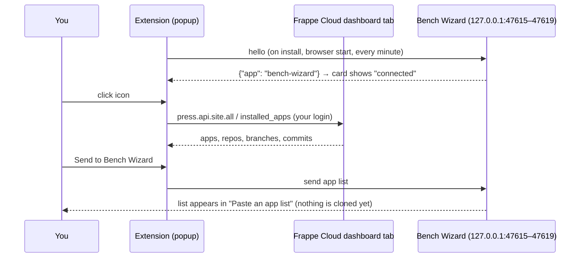

# Bench Wizard

A local web wizard that sets up a Frappe bench (version 15 or 16) on Ubuntu or macOS. It checks
prerequisites, installs what is missing, then runs `bench init`, `get-app`, `new-site`
and `install-app` for the apps you choose, optionally restoring a database backup. It can also
**add apps to a bench you already have**, or add a new site to it from a backup.

Python 3.10+ standard library only. No build step, no dependencies.



## Contents

- [What you can use it for](#what-you-can-use-it-for)
- [Quick start](#quick-start)
- [How it works](#how-it-works)
- [Using the wizard, step by step](#using-the-wizard-step-by-step)
- [Adding apps to an existing bench](#adding-apps-to-an-existing-bench)
- [Browser extension: copy apps from a Frappe Cloud site](#browser-extension-copy-apps-from-a-frappe-cloud-site)
- [Which GitHub account it uses](#which-github-account-it-uses)
- [Catalog: your own apps and presets](#catalog-your-own-apps-and-presets)
- [macOS](#macos) · [Troubleshooting](#troubleshooting) · [Tests](#tests) · [Notes](#notes) · [Future plans](#future-plans)

## What you can use it for

| You want to… | What the wizard does for you |
|---|---|
| **Onboard a developer** on a fresh Ubuntu or Mac | Installs Python, Node (via nvm), MariaDB, Redis, wkhtmltopdf, Yarn and the Bench CLI, then builds a working bench and site in one run. |
| **Reproduce a production issue locally** | Restores a `.sql`/`.sql.gz` backup (plus public/private files) as a new site, with switches that mute email, pause the scheduler and hold back webhooks/SMS so the copy cannot reach real customers. |
| **Mirror a Frappe Cloud site** | The [browser extension](#browser-extension-copy-apps-from-a-frappe-cloud-site) copies the site's apps, repos and branches into the wizard, so your local bench matches what runs in the cloud. |
| **Try an app** on a bench you already use | [Existing-bench mode](#adding-apps-to-an-existing-bench) fetches only what is missing, installs it on the site you pick and rebuilds assets. |
| **Standardise team setups** | A shared `catalog.json` (or your own `~/.config/bench-wizard/catalog.json`) gives everyone the same versions, apps and presets. |
| **Work with private apps** | Paste a token-carrying HTTPS URL or choose an SSH host alias; the token is kept in memory only and scrubbed from logs. |

## Quick start

```bash
git clone https://github.com/rajitjosh/bench-wizard.git
cd bench-wizard
./start.sh                                # or: python3 -m bench_wizard
```

It opens `http://127.0.0.1:<port>/` in your browser (local only, token protected). Keep the terminal open
while you use it; press Ctrl+C to stop.

| Option | What it does |
|---|---|
| `--install-desktop` | Adds an app-menu icon and exits (on a Mac: `~/Applications/Bench Wizard.app`). |
| `--app` | Opens the wizard in a window of its own and stops when that window is closed. The desktop icon uses this. |
| `--no-browser` | Starts the server and prints the URL without opening a browser. |
| `--port N` | Listens on port `N`. By default it takes the first free port of 47615–47619 (the extension looks there). |

## How it works

The wizard is a small Python HTTP server bound to `127.0.0.1` that serves a single-page UI. Every request
from the page carries a per-run token, so other local pages cannot drive it. Nothing is written to disk until
you press **Start setup** on the Review step.



Behind the Run step, a new bench is built in this order. Apps are installed in dependency order, worked out
from each app's own `pyproject.toml` and `hooks.py`:



## Using the wizard, step by step

### 1. Project

Choose **Create a new bench** or **Add apps to an existing bench** ([see below](#adding-apps-to-an-existing-bench)).
For a new bench pick:

- **Frappe version.** Version 15 (Python 3.11, Node 18) or Version 16 (Python 3.14, Node 24).
- **Preset.** A starting set of apps, for example *Plain ERPNext* or *Empty Frappe*. Folder and site name follow
  the preset until you edit them.
- **Bench folder** (must not exist yet, no spaces), **site name** (`*.localhost` opens in Chrome and Firefox
  without a hosts entry), optional **database name**, and the **Administrator password**.
- **Site data.** A new empty site, or **Restore from backup**: a `.sql`/`.sql.gz` path, optional public/private
  file archives, an optional backup encryption key and the source site's `encryption_key`.

### 2. System check



Each prerequisite is listed with the version required and found. Only failing rows are installed: with `apt`
and sudo on Ubuntu, or Homebrew on a Mac. The wizard then needs the **MariaDB root password** to create the
site database. Click **Verify**. If root has no password yet (a fresh install), it can set the one you typed.
**Continue** unlocks once every row is OK and the password is verified.

### 3. Apps



- Tick apps from the catalog; each shows its repo, branch (tags work too) and what it requires. Selecting an
  app also selects what it needs.
- **Add a custom app** from any Git URL. Its name and requirements are read from the repository.
- **Paste an app list** as JSON, `[{"url": "…", "branch": "…"}]`. This is what the
  [extension](#browser-extension-copy-apps-from-a-frappe-cloud-site) fills for you.
- **Import from Frappe Cloud** shows whether the extension is connected.

Private HTTPS URLs may carry a token (`https://<token>@github.com/org/repo.git`). It is passed to git through
the environment, held in memory for the session only, and scrubbed from logs.

### 4. Review



The exact commands that will run (secrets shown as `••••`), the install order, and pre-flight checks: bench
folder free, MariaDB login, disk space, `git ls-remote` for every app, Python, Bench CLI and Node.
**Start setup** is disabled while any check fails.

### 5. Run

A live log for each step. If a step fails, the run stops there. Fix the cause, then **Retry step N**. If the step
cannot run over a partial result, the wizard cleans that up first. **Cancel** stops the current step and leaves
what was created on disk.

### 6. Done

How to start the bench (`cd <folder> && nvm use && bench start`), the site URL and login, the installed apps, and the
command to update later:

```bash
cd ~/frappe-bench && nvm use && bench update --pull --build --patch
```

For a restored site it also lists which safety switches were applied.

## Adding apps to an existing bench



Choose **Add apps to an existing bench** on the Project step, type the bench folder (the one holding `apps/`
and `sites/`) and click **Load bench**. The wizard reads:

- the **Frappe version**, from `apps/frappe/frappe/__init__.py` (it must be a version in the catalog),
- the **Node version**, from the bench's `.nvmrc`, or your nvm default if there is none,
- the **apps in the bench**, from `sites/apps.txt`,
- each **site** and the apps installed on it, via `bench --site <site> list-apps`.

Then pick one of:

- **An existing site.** The wizard goes straight to Apps. Apps already in the bench show *already in the bench*
  and are only installed on the site; the rest are fetched.
- **New site from a backup.** Restore a production backup as a new site of this bench, for example to look
  into an issue. You get the same file, key and safety-switch fields as a new bench.



Nothing in this mode removes anything from the bench, and the existing site keeps its own database login, so the
MariaDB root password is not needed unless you add a site. If the bench has no `.nvmrc`, or an app needs a newer
Node than the bench uses, the wizard writes the bench's `.nvmrc` so `nvm use` picks the right one.

## Browser extension: copy apps from a Frappe Cloud site

`extension/` is a small browser extension for Chromium-based browsers (Chrome, Edge, Brave). It lists
the apps on one of your Frappe Cloud sites as `[{"app", "url", "branch", "commit"}]` and sends them to the
wizard's Apps step.

### Install it

Browsers do not let a web page install an extension, so you load it once by hand. The wizard's Apps step shows
these steps in its **Import from Frappe Cloud** card until the extension connects, and its **Show folder** button
opens the `extension` folder for you.

| Browser | Open this page | Then |
|---|---|---|
| Chrome | `chrome://extensions` | Turn on **Developer mode** (top right) → **Load unpacked** → pick `bench-wizard/extension`. |
| Edge | `edge://extensions` | Turn on **Developer mode** (left sidebar) → **Load unpacked** → pick `bench-wizard/extension`. |
| Brave | `brave://extensions` | Turn on **Developer mode** (top right) → **Load unpacked** → pick `bench-wizard/extension`. |

Then pin it: click the puzzle-piece icon in the toolbar and pin **Bench Wizard: Frappe Cloud export**.

Firefox and Safari are not supported (the extension uses a Chromium Manifest V3 service worker).

**Updating.** After `git pull`, open the extensions page and click the reload icon on the extension's card.
**Removing.** Click **Remove** on the same card.

### Use it

1. Start the wizard and go to the **Apps** step. The Import from Frappe Cloud card turns to *connected* within a
   minute of the browser starting (or right after you load the extension).
2. Log in at `cloud.frappe.io/dashboard` (or `frappecloud.com/dashboard`). Open a site there to preselect it,
   then click the extension's icon.
3. Pick the site if needed and click **Send to Bench Wizard**. The list lands in **Paste an app list** for you to
   check before you click to add it. **Copy JSON** and **Download** work too, for example to share the list.



### Privacy and limits

- It calls the dashboard's own API (`press.api.site.all`, `press.api.site.installed_apps`) from inside the
  dashboard tab with your existing login. It stores nothing and needs no API key.
- These are internal dashboard endpoints, so a Frappe Cloud change may break it.
- Private repos still need your own Git token, or an [SSH host alias](#which-github-account-it-uses), in the wizard.
- A site may run an older commit than its branch head; the wizard clones the branch.
- The wizard listens on the first free port of 47615–47619 so the extension can find it. With `--port` it cannot.
- The two calls the extension makes need no token but are refused unless they come from an extension
  (`Origin: chrome-extension://…`), which web pages cannot fake. They only fill the import box.

## Which GitHub account it uses

With several GitHub accounts as SSH host aliases in `~/.ssh/config`, pick the one the wizard uses in
`~/.config/bench-wizard/settings.json`:

```json
{"github_ssh_host": "github-work"}
```

Every GitHub URL the wizard fetches (HTTPS or SSH, for `bench init`, `get-app` and the checks) then goes over
SSH through that alias and its key. It is passed to git through the environment of the wizard's own commands
only; your git config and other projects are unchanged. A token inside a URL still wins for its owner. The
bench's own remotes keep their original URLs, so a later `bench update` uses your normal git setup.

## Catalog: your own apps and presets

`catalog.json` lists Frappe versions, apps and presets. Add your own in `~/.config/bench-wizard/catalog.json`;
it is merged on top, and its presets show a *Local* badge.

```json
{
  "apps": {
    "my_app": {
      "title": "My App",
      "description": "Our internal customisations.",
      "repo": "git@github.com:my-org/my_app.git",
      "branches": {"version-15": "version-15", "version-16": "develop"},
      "requires": ["frappe", "erpnext"],
      "private": true
    }
  },
  "presets": {
    "my-stack": {"title": "My stack", "description": "ERPNext and My App.", "apps": ["erpnext", "my_app"]}
  }
}
```

An app with no branch for the chosen Frappe version shows *Not available* and cannot be selected.

## macOS

Install [Homebrew](https://brew.sh) first; the wizard installs everything else through it, as your user.
Homebrew no longer packages wkhtmltopdf, so the wizard installs the upstream `.pkg` with sudo; it is an Intel
build and runs under Rosetta on Apple silicon. MariaDB runs as a Homebrew service, and the charset settings go to
`$(brew --prefix)/etc/my.cnf.d/99-frappe.cnf`. The app icon is `bench_wizard/web/icon.icns`, built from
`icon-mac.svg` (render it at 1024px, make an `.iconset` with `sips`, then run `iconutil -c icns`). In `--app` mode the wizard keeps running until you quit the
browser window with ⌘Q, since closing a window does not quit a Mac app.

The window belongs to a browser process of its own, so in the Dock it shows as a second browser icon (and
a minimised window goes into that icon when "Minimise windows into application icon" is on). Opening Bench
Wizard again, from Spotlight or the Applications folder, brings that window back, un-minimising it; only
if it was closed does a new one open. The wizard drives its window over the browser's DevTools protocol
on a private pipe (`--remote-debugging-pipe`), not a network port.

On Linux the launcher's `StartupWMClass` lets the desktop focus the open window itself. A snap browser
(Ubuntu's Chromium) keeps its window profile in `~/snap/<name>/common/`, since snaps cannot use hidden
folders in your home, and runs without the DevTools pipe, so reopening there opens a new window.

## Troubleshooting

| Symptom | What to do |
|---|---|
| **Continue to apps** stays disabled | Every System check row must be OK *and* the MariaDB root password verified. |
| "MariaDB did not accept this password" | Correct it, or on a fresh install use **Set this as the root password** (needs sudo). |
| **Start setup** is disabled | A pre-flight check failed. Fix it (for example remove a leftover bench folder) and click **Re-run checks**. |
| A step failed during Run | Open the step's log, fix the cause, then **Retry step N**. `pip`/`yarn` cache clashes usually pass on retry. |
| The extension card never shows *connected* | Start the wizard without `--port`, reload the extension, and make sure ports 47615–47619 are not all taken. |
| "this bench runs Frappe N" when loading a bench | Existing-bench mode supports only the versions in the catalog (15 and 16). |
| A site shows "Cannot read its apps" | `bench --site <site> list-apps` failed. Check that MariaDB is running and the site's config is valid. |

## Tests

```bash
python3 -m unittest discover -s tests
```

## Notes

- Bench folder paths must not contain spaces.
- Passwords and tokens are never written to disk or shown in logs.
- A new bench always goes into a new folder. Existing-bench mode only adds apps, or a new site, to a bench; it
  never removes anything.
- Screenshots in this README were taken from a real run, with demo bench data and a placeholder home folder.

## Future plans

**Several setups at once.** Today every window talks to one wizard, which holds one plan and one run: a second
window shows the setup already running, and starting another is refused. To set up two benches side by side:

1. **Unique Redis ports per bench.** `bench init` picks ports from sibling bench folders, so two benches made at
   the same time, or in different parent folders, can both get 11000/13000 and clash. The wizard should pick free
   ports itself and write them to the bench's config right after `bench init`. Worth doing even for one setup at
   a time.
2. **One System check install at a time.** Homebrew and apt hold locks, so installs from different setups
   should queue.
3. **Sessions.** Each window gets its own plan, run, log stream and Done screen; opening the app again starts a
   new session, and a "running setups" list reopens one whose window was closed. Bench folders and site names
   are checked against other active sessions.

Concurrent `pip` and `yarn` runs share caches and can occasionally fail; retrying the step is the fallback.
